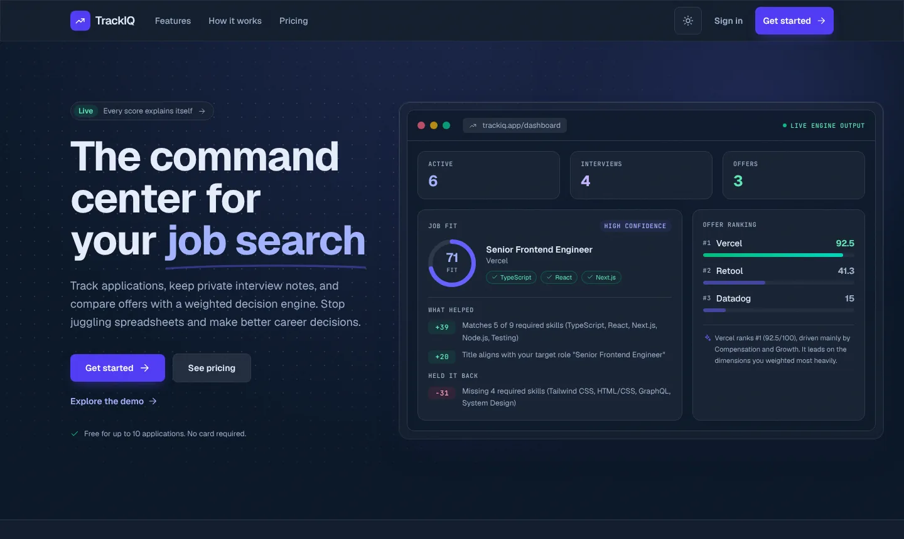
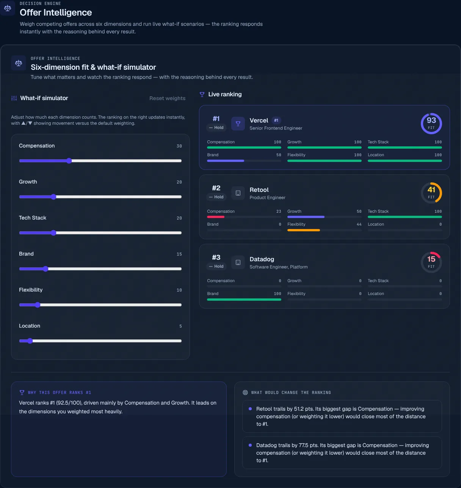
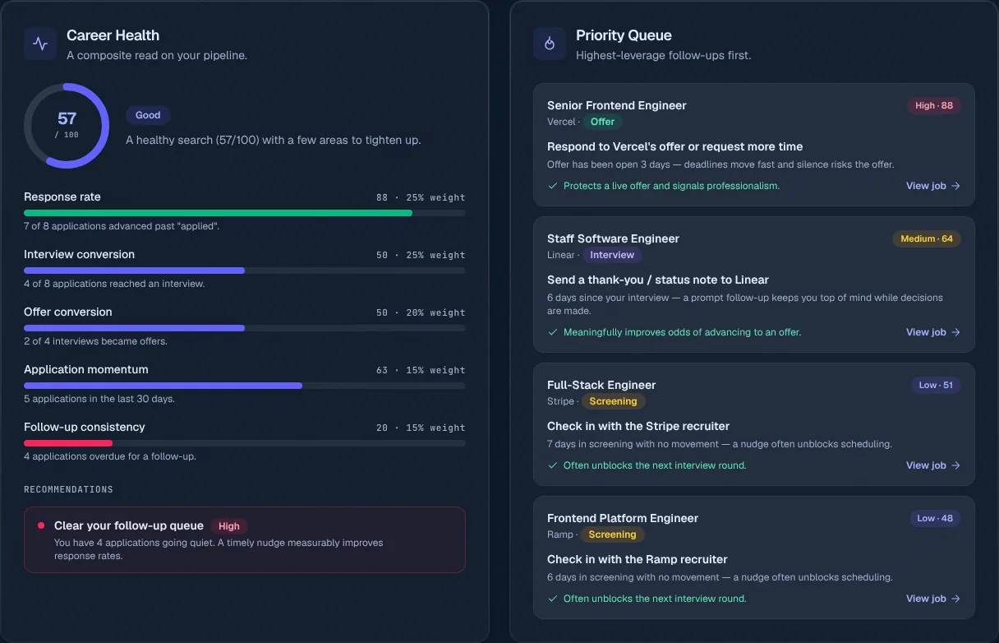
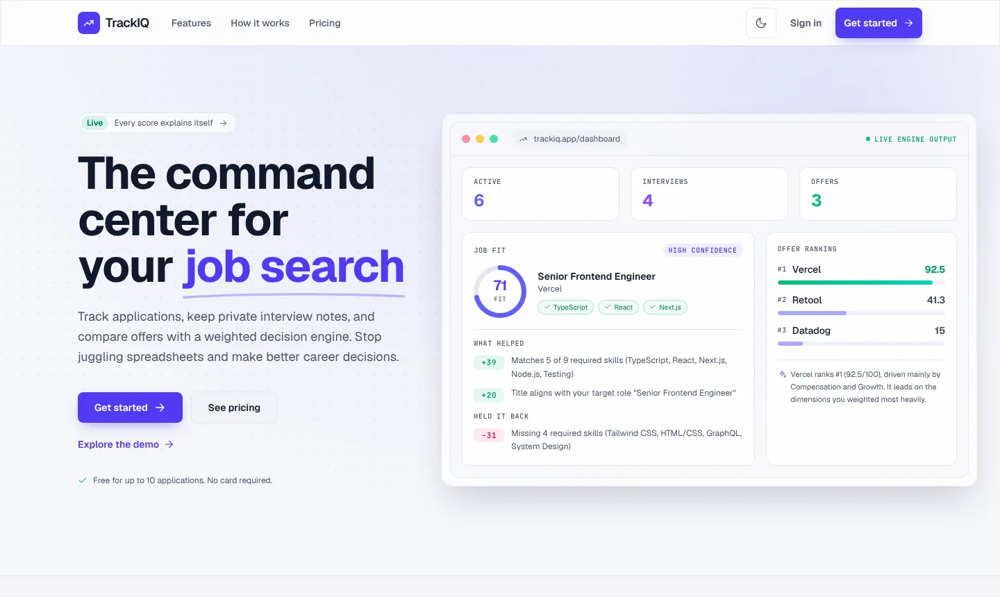
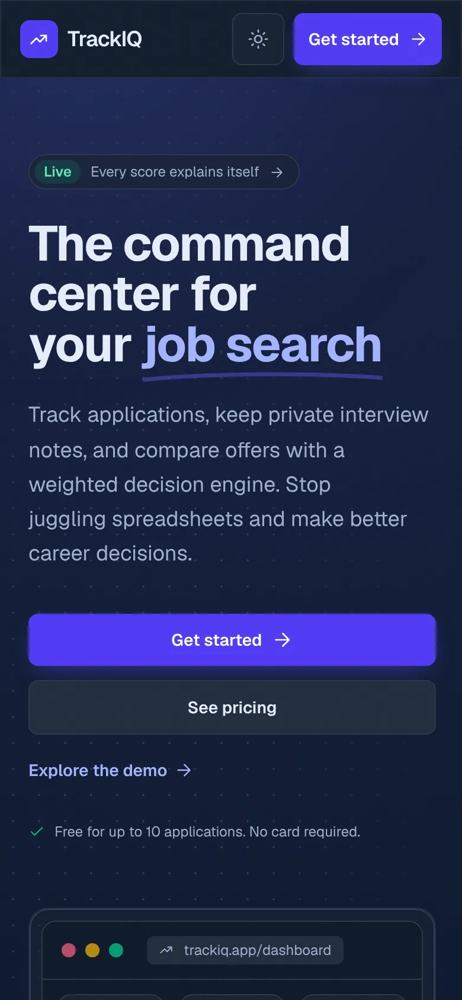

# TrackIQ

**A job-search command center with explainable scoring.** Track applications,
keep private interview notes, and compare offers with six deterministic engines
that show their work — every score breaks down into what helped and what held it
back.

[](https://github.com/hemangbhat/TrackIqPro/actions/workflows/ci.yml)


[](LICENSE)

**[Live app](https://track-iq-pro.vercel.app)** · **[Demo with sample data — no sign-up](https://track-iq-pro.vercel.app/demo)** · **[Architecture & design notes](docs/README.md)**



## Features

**Track**
- **Application tracker** — full CRUD across 7 stages, with search, filter, and sort.
- **Interview notes** — private notes linked to an application and interview round.
- **Analytics** — KPI cards, an applications timeline, and a stage breakdown.

**Decide — six explainable engines** (pure TypeScript in `lib/`, unit- and property-tested)
- **Offer Intelligence** — six dimensions, min-max normalized across your offers,
  user-weighted, with a live **what-if simulator** and a "path to #1" for every runner-up.
- **Job Fit** — scores each role against your skills, target title, and seniority.
- **Career Health** — one grade from five weighted pipeline metrics, plus next actions.
- **Follow-up Priority Queue** — stale applications ranked by stage value and urgency;
  also sent as a daily email digest.
- **Interview Reflection** — strengths, weak spots, and a confidence trend from your notes.

**Run as a real SaaS**
- **Billing** — Stripe Checkout; plans change *only* via signature-verified webhooks;
  free/Pro gating enforced on the server; customer portal.
- **Production hardening** — per-user rate limiting (Upstash), transactional email
  (Resend), daily reminder cron (Vercel) with Redis de-duplication.
- **Polished UX** — light/dark mode, responsive down to 375px, skeleton/empty/error
  states, accessible dialogs, reduced-motion support.

<table>
  <tr>
    <td width="50%"></td>
    <td width="50%"></td>
  </tr>
  <tr>
    <td><em>Offer Intelligence — re-weight dimensions and watch the ranking respond.</em></td>
    <td><em>Career Health and the follow-up Priority Queue.</em></td>
  </tr>
</table>

<details>
<summary>Light mode and mobile</summary>



</details>

## Quality

- 260 tests (Vitest, Testing Library, fast-check property tests, vitest-axe).
- GitHub Actions CI runs lint, typecheck, tests, and a production build.
- Presenting this project? See [`docs/INTERVIEW_GUIDE.md`](docs/INTERVIEW_GUIDE.md) and the readiness checklist in [`docs/INTERVIEW_READINESS.md`](docs/INTERVIEW_READINESS.md).

## Tech stack

- **Next.js 15.5** (App Router for UI, Pages Router for API routes)
- **TypeScript**, **Tailwind CSS v4**
- **MongoDB** + **Mongoose**
- **Clerk** for authentication
- **Stripe** for subscriptions
- **Chart.js** for analytics
- **Upstash Redis** (rate limiting), **Resend** (email), **Vercel Cron**
- **Vitest**, **Testing Library**, **fast-check**, **vitest-axe**

## Architecture

- `src/app/**` — App Router pages (landing, dashboard, pricing, auth).
- `pages/api/**` — REST API routes. Every data route is authenticated with Clerk
  via `withAuth` and scoped to the signed-in user.
- `models/**` — Mongoose schemas (`Job`, `Offer`, `Note`, `UserPlan`, …).
- `lib/**` — the six scoring engines, plan gating, rate limiting, email, DB connection.
- `hooks/**` — data hooks (`useJobs`, `useNotes`, `useOffers`, `useCareerProfile`).
- `components/ui/**` — design-system primitives (Button, Card, Modal, Toast, …).

Security highlights: all reads/writes are user-isolated, Stripe webhooks are
signature-verified, plan upgrades happen **only** after a successful payment
webhook (never at checkout creation), and the billing portal resolves the
customer ID from the server-side record rather than client input.

## Getting started

1. Install dependencies:

   ```bash
   npm install
   ```

2. Copy the environment template and fill in your keys:

   ```bash
   cp .env.example .env.local
   ```

   | Variable | Description |
   |----------|-------------|
   | `MONGODB_URI` | MongoDB connection string |
   | `NEXT_PUBLIC_CLERK_PUBLISHABLE_KEY` / `CLERK_SECRET_KEY` | Clerk auth keys |
   | `STRIPE_SECRET_KEY` | Stripe secret key |
   | `STRIPE_WEBHOOK_SECRET` | Signing secret for the webhook endpoint |
   | `STRIPE_PRICE_ID` | Price ID of the Pro subscription |

3. Run the dev server:

   ```bash
   npm run dev
   ```

   Open [http://localhost:3000](http://localhost:3000).

### Stripe webhooks (local)

Forward events to the local webhook handler:

```bash
stripe listen --forward-to localhost:3000/api/stripe/webhook
```

Use the printed signing secret as `STRIPE_WEBHOOK_SECRET`.

## Deployment (Vercel)

1. Push to GitHub and import the repo into Vercel.
2. Add all environment variables from `.env.example` in the Vercel project settings.
3. Add a Stripe webhook endpoint pointing at
   `https://<your-domain>/api/stripe/webhook` and set `STRIPE_WEBHOOK_SECRET`.
4. Deploy. `npm run build` runs cleanly with no lint or type errors.

## Scripts

| Command | Description |
|---------|-------------|
| `npm run dev` | Start the dev server |
| `npm run build` | Production build |
| `npm run start` | Run the production build |
| `npm run lint` | Lint the project |
| `npm run typecheck` | Type-check the whole project, tests included |
| `npm test` | Run the test suite |

## License

[MIT](LICENSE)
